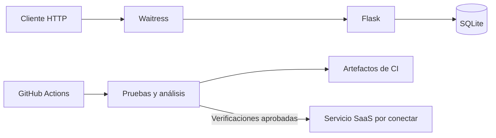

# FD04 · Arquitectura de software

**MesaQA · Versión 0.1**

## Decisiones

- Waitress sirve la API fuera del modo de depuración. El contenedor se ejecuta como usuario con UID 10001.
- La fábrica de aplicación recibe la ruta de la base, lo que permite que cada prueba use un archivo aislado.
- SQLite conserva el estado de las incidencias con una restricción de estados y transacciones de escritura. El prototipo usa orden descendente por identificador y no necesita caché.
- El límite de tamaño y la validación se aplican antes de escribir. El despliegue público de demostración sólo debe usar registros ficticios.
- GitHub Actions verifica cobertura de línea, patrones estáticos y avisos de dependencias. Los resultados se conservan como artefactos separados.

## Entornos

| Entorno | Estado | Persistencia |
|---|---|---|
| Pruebas | Suite local ejecutada | Archivo temporal por prueba |
| Desarrollo | Arranque local documentado | SQLite bajo data/ |
| SaaS | Blueprint preparado | Configuración de volumen pendiente |

Las decisiones de identidad, trazabilidad de cada cambio e integraciones dependen de la segunda fase. En el MVP se puede verificar la disponibilidad con /health y la persistencia con una segunda instancia apuntando al mismo archivo.
